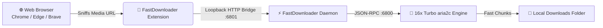

<div align="center">

  

  # ⚡ FastDownloader Pro
  
  **The ultra-fast, obsidian-glass alternative to Internet Download Manager (IDM).**
  
  *16-stream parallel turbo chunks • IDM-grade scheduler • Smart browser sniffer • ~30MB RAM footprint*

  <br />

  [](https://github.com/ZaxMil/fast-downloader/releases/latest)
  [](https://microsoft.com/windows)
  [](LICENSE)
  [](https://github.com/aria2/aria2)
  [](README.md#architecture)

  <br />

  <a href="https://github.com/ZaxMil/fast-downloader/releases/latest">
    
  </a>

</div>

<br />

<p align="center">
  
</p>

---

## ⚡ Why FastDownloader?

Most modern download managers are either **bloated 200MB+ Electron apps** or stuck in **Windows 98-era UI with adware and paid licenses**. 

FastDownloader Pro gives you the raw downloading power of **IDM** paired with a sleek **obsidian glassmorphic interface**, native Windows performance, and zero telemetry.

| Feature | ⚡ FastDownloader Pro | 🐢 Standard Browser | 💾 IDM (Commercial) | 📦 Electron Downloaders |
| :--- | :---: | :---: | :---: | :---: |
| **Download Speed** | **16x Parallel Turbo** | 1x Single Stream | 16x Parallel | 4x - 8x |
| **Memory Footprint** | **~30 MB (Edge App)** | Shared (~1-2 GB) | ~15 MB | 180 MB - 350 MB |
| **Scheduler & Night Queue** | **Included (Auto-Shutdown)** | ❌ No | Paid Feature | Rare / Basic |
| **Modern Cyberpunk UI** | **Obsidian Glass + 60fps Waveform** | ❌ Boring List | ❌ 1990s Toolbar | ⚠️ Sluggish |
| **Browser Video Grabber** | **1-Click Floating Button** | ❌ No | Included | Plugin needed |
| **Price & Adware** | **100% Free & Open Source** | Free | \$24.95 / Yearly | Adware / Freemium |

---

## 🚀 Key Superpowers

<table>
  <tr>
    <td width="50%" valign="top">
      <h3>⚡ 16-Connection Parallel Turbo</h3>
      <p>Splits every download into up to 16 concurrent byte-range streams via an embedded, tuned <code>aria2c</code> engine. Maxes out your connection throughput even on heavily throttled web servers.</p>
    </td>
    <td width="50%" valign="top">
      <h3>⏱️ IDM-Grade Queue Scheduler</h3>
      <p>Separate <b>Main Queue</b> and <b>Night Queue</b> with automated start/stop timers (e.g. 02:00 AM – 07:00 AM), sequential 1-by-1 downloads, and automatic PC shutdown on completion.</p>
    </td>
  </tr>
  <tr>
    <td width="50%" valign="top">
      <h3>📊 60 FPS Real-Time Bandwidth Monitor</h3>
      <p>A silky-smooth, neon emerald canvas oscilloscope tracks your instantaneous bandwidth, rolling transfer history, active chunk connections, and disk drive headroom live.</p>
    </td>
    <td width="50%" valign="top">
      <h3>🧩 1-Click Floating Browser Sniffer</h3>
      <p>Companion extension for <b>Chrome</b>, <b>Edge</b>, and <b>Brave</b> injects discrete <code>[ ⬇ Download ]</code> buttons over video players and intercepts video streams, canvases, and media URLs.</p>
    </td>
  </tr>
  <tr>
    <td width="50%" valign="top">
      <h3>🧲 BitTorrent & Magnet Integration</h3>
      <p>Native parsing for <code>.torrent</code> files and <code>magnet:?xt=</code> links with active DHT network discovery, peer exchange (PEX), and per-torrent chunk telemetry.</p>
    </td>
    <td width="50%" valign="top">
      <h3>🪶 Zero-Bloat Native Architecture</h3>
      <p>No heavy Node.js or Chromium runtime bundled. Launches via Windows Edge App Mode in milliseconds with an OS-level mutex guaranteeing a single window at all times.</p>
    </td>
  </tr>
</table>

---

## 📥 Quick Start

### Option A: Ready-to-Run (Recommended)
1. Download **`FastDownloader.exe`** from the [Latest Releases](https://github.com/ZaxMil/fast-downloader/releases/latest).
2. Run the helper engine setup to download authentic upstream tools (`aria2c`, `yt-dlp`, `ffmpeg`):
   ```powershell
   powershell -ExecutionPolicy Bypass -File scripts\setup-binaries.ps1
   ```
3. Double-click **`FastDownloader.exe`** and enjoy turbo downloads!

<details>
<summary><b>Option B: Build From Source in 2 Seconds (Zero SDKs Required)</b></summary>
<br />

Every Windows machine has the C# `.NET Framework` compiler pre-installed:

```cmd
:: 1. Clone repository
git clone https://github.com/ZaxMil/fast-downloader.git
cd fast-downloader

:: 2. Fetch official helper engines
powershell -ExecutionPolicy Bypass -File scripts\setup-binaries.ps1

:: 3. Compile in 1 second using built-in csc.exe
build.bat

:: 4. Run
FastDownloader.exe
```
</details>

---

## 🧩 Installing the Browser Extension

Install the companion extension to catch downloads and video streams directly from your browser:



1. Navigate to your browser's extension dashboard:
   - **Chrome**: `chrome://extensions`
   - **Microsoft Edge**: `edge://extensions`
   - **Brave**: `brave://extensions`
2. Enable **Developer mode** (toggle in top-right corner).
3. Click **Load unpacked** and select the [`extension/`](extension/) directory.

---

## 🏗️ Architecture

```
fast-downloader/
├── src/
│   └── Program.cs             # C# .NET daemon (HTTP Bridge :6801, System Tray, Mutex & Scheduler)
├── ui/
│   ├── index.html             # Obsidian glassmorphic dashboard (Single-page app, ~60fps Canvas)
│   ├── favicon.ico            # Dashboard favicon
│   ├── logo.png               # High-res 3D neon logo
│   └── preview.png            # Application preview screenshot
├── extension/                 # Manifest V3 companion browser extension
│   ├── manifest.json
│   ├── background.js          # Background capture service worker
│   ├── content.js             # Floating grabber injector
│   ├── content.css            # Dark glassmorphic widget styles
│   └── icons/
├── scripts/
│   └── setup-binaries.ps1     # Upstream binary installer (aria2c, yt-dlp, ffmpeg)
├── build.bat                  # 1-click Windows compiler script
├── DISCLAIMER.md              # Legal acceptable use policy
├── THIRD_PARTY_NOTICES.md     # Upstream licenses (GPL, LGPL, Unlicense)
└── LICENSE                    # MIT License
```

---

## ⚖️ Legal & Open Source Compliance

- **Permissive License**: FastDownloader Pro is licensed under the [MIT License](LICENSE).
- **Third-Party Engines**: Uses unmodified prebuilt versions of `aria2` (GPL-2.0+), `yt-dlp` (The Unlicense), and `FFmpeg` (LGPL/GPL). Full credits and source code links are provided in [THIRD_PARTY_NOTICES.md](THIRD_PARTY_NOTICES.md).
- **Authorized Use**: Intended solely for downloading files and media you have the legal authorization to download. See [DISCLAIMER.md](DISCLAIMER.md).

---

<div align="center">

  **Crafted with ⚡ speed in 2026.**
  
  *If FastDownloader Pro speeds up your downloads, give it a ⭐ star on GitHub!*

</div>
