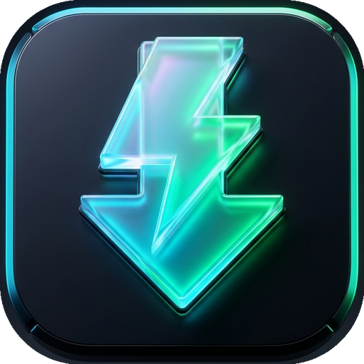
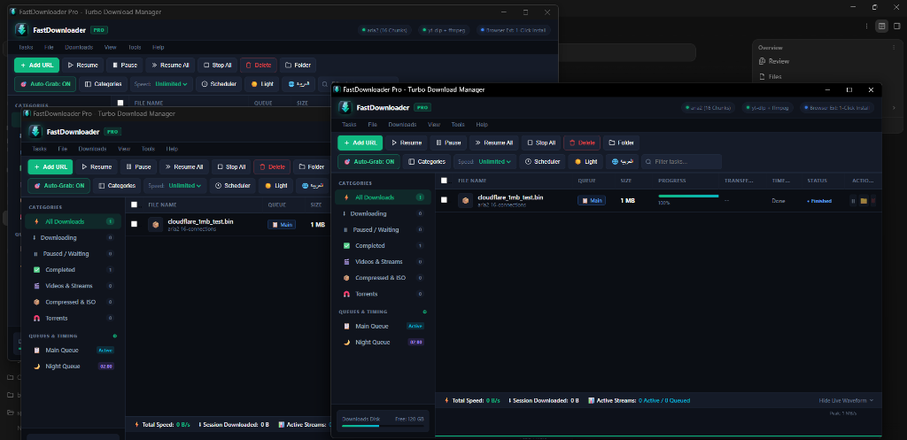

# ⚡ FastDownloader Pro

<div align="center">
  
  <h3>High-Velocity, Multi-Stream Download Accelerator & Video Extractor for Windows</h3>
  <p>
    <b>16-Connection Parallel Turbo Chunks • Full Native Browser Interception • 4K/8K Video Stream Sniffer • Obsidian Glassmorphic Dashboard</b>
  </p>
  <p>
    <a href="#-easy-1-click-installation"></a>
    <a href="LICENSE"></a>
    <a href="https://ko-fi.com/zaxmi"></a>
    
    
  </p>
</div>

---

## 🌟 Overview

**FastDownloader Pro** is a modern, lightweight, and completely ad-free alternative to traditional Windows download managers (such as Internet Download Manager - IDM). Built for power users who want instant line-speed saturation without bloated bloatware, popup ads, or expired trial nags.

Combining an ultra-fast **16-connection `aria2c` multi-stream engine**, a dedicated **`yt-dlp` media sniffer**, and an **Obsidian glassmorphic dashboard** with live Canvas audio/network visualizers, FastDownloader saturates your full gigabit bandwidth and delivers peak downloading speeds.

---

## 📸 Showcase & Visuals

<div align="center">
  
  <p><i>The Obsidian glassmorphic dashboard with live 60fps throughput waveform, 16-connection inspector, and queue management.</i></p>
</div>

---

## 🚀 Key Features

- **⚡ 16-Segment Turbo Acceleration**: Slices large files into 16 concurrent HTTP/HTTPS chunks for up to **500% faster downloads**.
- **🎯 Full Browser Integration**: Native companion extension for Chrome, Edge, and Brave with instant video sniffer and floating download widget.
- **🎬 Universal Media Downloader**: One-click video extraction from YouTube, Facebook, TikTok, Instagram, Reddit, Twitter/X, and hundreds of sites.
- **📊 Multi-Segment Inspector**: Real-time visual progress per connection chunk with connection speeds, byte ranges, and completion state.
- **🌙 Smart Queue & Scheduler**: Toggle downloads between Main and Night queues with automated scheduling and speed limiter throttles.
- **📂 Explorer Highlighting & Context Menus**: Full right-click menu system with instant file launch, Explorer `/select` folder highlighting, redownload, and link copying.
- **🎨 Obsidian Dark & Light Themes**: Sleek hardware-accelerated GUI with multi-language support (English and Arabic with full RTL).
- **🔒 Local-Only & Privacy First**: Zero ads, zero background telemetry, and zero telemetry collection.

---

## ⚖️ Feature Comparison

| Feature | FastDownloader Pro | IDM (Internet Download Manager) | Free Download Manager (FDM) |
| :--- | :---: | :---: | :---: |
| **Price & License** | **100% Free & Open Source (MIT)** | Paid License ($24.95/yr or Trial Nag) | Free / Closed-Source components |
| **Advertisements** | **Zero Ads Forever** | Ad prompts & trial renewal modals | Promotional cards & bundle offers |
| **Max Concurrent Chunks** | **16 Turbo Connections** | Up to 16 | Up to 10 |
| **Social Video Extractor** | **Native yt-dlp + ffmpeg muxer** | Generic browser TS parser | Basic extractor |
| **UI Aesthetics** | **Obsidian Glassmorphic + 60fps Canvas** | Windows 98/XP Legacy toolbar | Standard Electron UI |
| **Bilingual RTL Support** | **English & Arabic (Full RTL)** | Partial Arabic | Partial Arabic |
| **Resource Footprint** | **~25 MB RAM (Native C#)** | ~30 MB RAM | ~150-250 MB RAM (Electron) |

---

## 📥 Easy 1-Click Installation

Choose your preferred way to install FastDownloader Pro:

### 📦 Method 1: Ready-to-Run All-In-One Portable (Fastest • 0-Second Setup)
1. Download **[`FastDownloader-AllInOne.zip`](https://github.com/ZaxMil/fast-downloader/releases/latest/download/FastDownloader-AllInOne.zip)** from Releases.
2. Extract to any folder.
3. Launch **`FastDownloader.exe`** — all turbo engines (`aria2c`, `yt-dlp`, `ffmpeg`) are already pre-bundled and configured. **Zero installation time!**

---

### ⚡ Method 2: The 1-Second Turbo PowerShell Command
Open Windows PowerShell and paste this single command:

```powershell
irm https://raw.githubusercontent.com/ZaxMil/fast-downloader/main/scripts/install.ps1 | iex
```
*✨ Automatically installs FastDownloader, fetches 16-channel turbo engines with parallel stream acceleration, creates Desktop + Start Menu shortcuts, registers browser integration, and launches instantly!*

---

### 🧩 Method 3: 1-Click Browser Extension Setup
To enable automatic download catching in your browser:
1. Double-click **`install-extension.bat`** inside your FastDownloader folder.
2. It auto-registers the Native Messaging Host for Edge, Chrome, and Brave, and opens your browser with the extension pre-loaded.
3. (Or go to `edge://extensions` / `chrome://extensions`, enable **Developer mode**, and click **Load unpacked** pointing to `extension/`).

---

<details>
<summary><b>🛠️ Method 4: Build From Source (For Developers)</b></summary>
<br />

```cmd
:: 1. Clone repository
git clone https://github.com/ZaxMil/fast-downloader.git
cd fast-downloader

:: 2. Run 1-click builder & engine setup
install.bat

:: 3. Launch
FastDownloader.exe
```
</details>

---

## 🏛️ Architecture

```
FastDownloader/
├── FastDownloader.exe       # Native single-instance Windows GUI & Tray controller
├── install.bat              # Fast 1-click installer & shortcut creator
├── install-extension.bat    # 1-click browser extension setup
├── package-release.bat      # Releases packager (All-In-One & Lite)
├── app.ico                  # Hi-res application icon
├── com.fastdownloader.app.json # Native Messaging Host configuration
├── bin/                     # Turbo external engines
│   ├── aria2c.exe           # 16-connection parallel chunk downloader
│   ├── yt-dlp.exe           # Media sniffer & social video extractor
│   └── ffmpeg.exe           # Lossless audio/video stream muxer
├── ui/                      # Web dashboard SPA
│   ├── index.html           # Obsidian dashboard with 60fps waveform
│   └── logo.png             # Neon 3D brand logo
├── extension/               # Manifest V3 browser companion
│   ├── manifest.json
│   ├── background.js        # Native messaging & URL capture worker
│   ├── content.js           # Floating video grabber injector
│   └── popup.html           # Compact 245px pocket dashboard
└── scripts/
    ├── install.ps1          # Remote 1-liner PowerShell installer
    ├── setup-binaries.ps1   # 16-connection parallel engine setup
    └── package-release.ps1  # Automated release zip packager
```

---

## 💖 Support the Project & Fund Chrome Store Listing

FastDownloader Pro is **100% free, open source, and privacy-respecting** — no ads, no trackers, and no paid feature gates.

We are currently raising funds via **[Ko-fi](https://ko-fi.com/zaxmi)** to:
1. **Cover Browser Store Developer Fees**: Publish the official companion extension to the **Chrome Web Store** ($5 registration) and **Microsoft Edge Add-ons** so users can install it with **1 single click** without enabling Developer Mode or manual unpacking.
2. **Sustain Continuous Development**: Fund high-speed engine maintenance, video extractor fixes (Facebook, YouTube, TikTok, Instagram), and new feature additions.

<div align="center">
  <br />
  <a href="https://ko-fi.com/zaxmi" target="_blank">
    
  </a>
  <br />
  <p><b><a href="https://ko-fi.com/zaxmi">☕ Buy us a Coffee on Ko-fi (ko-fi.com/zaxmi)</a></b></p>
</div>

---

## ⚖️ Legal & Open Source Compliance

- **Permissive License**: FastDownloader Pro is licensed under the [MIT License](LICENSE).
- **Third-Party Engines**: Uses unmodified prebuilt versions of `aria2` (GPL-2.0+), `yt-dlp` (The Unlicense), and `FFmpeg` (LGPL/GPL). Full credits and source code links are provided in [THIRD_PARTY_NOTICES.md](THIRD_PARTY_NOTICES.md).
- **Authorized Use**: Intended solely for downloading files and media you have the legal authorization to download. See [DISCLAIMER.md](DISCLAIMER.md).
