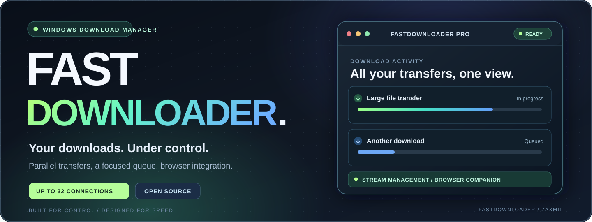

<div align="center">

  

  <h1>FastDownloader Pro</h1>
  <p><strong>A modern, open-source download manager for Windows.</strong><br/>
  Handle files, manage queues and capture supported downloads from your browser — without a cluttered workflow.</p>

  <p>
    <a href="https://github.com/ZaxMil/fast-downloader/releases/latest/download/FastDownloader-Setup.exe"></a>
    <a href="https://github.com/ZaxMil/fast-downloader/releases/latest"></a>
    <a href="#-browser-companion"></a>
  </p>

  <p>
    <a href="https://github.com/ZaxMil/fast-downloader/releases"></a>
    <a href="LICENSE"></a>
    
    <a href="https://github.com/ZaxMil/fast-downloader/stargazers"></a>
  </p>

  <p>
    <a href="#-meet-fastdownloader">Overview</a> ·
    <a href="#-get-started">Install</a> ·
    <a href="#-browser-companion">Browser companion</a> ·
    <a href="#-for-developers">Developers</a> ·
    <a href="#-privacy--responsible-use">Privacy &amp; safety</a>
  </p>
</div>

---

## ✨ Meet FastDownloader

**Download more comfortably. Manage everything in one place.**

FastDownloader Pro combines a Windows desktop app, a visual download queue and an optional browser extension. It uses established third-party download tools rather than asking you to juggle separate interfaces.

<div align="center">
  <a href="ui/Preview%20UI.png">
    
  </a>
  <p><sub>Actual application interface from this repository. Click to enlarge.</sub></p>
</div>

<table>
  <tr>
    <td width="50%" valign="top">
      <h3>⚡ Segmented downloads</h3>
      Use parallel file segments where supported by the server. The <a href="https://github.com/ZaxMil/fast-downloader/releases/tag/v0.1.7">v0.1.7 release notes</a> describe up to <strong>32 connections</strong> and dynamic chunking.
    </td>
    <td width="50%" valign="top">
      <h3>🗂️ An organized download queue</h3>
      Pause and resume downloads, inspect progress, organize files, and control transfer limits from a single dashboard.
    </td>
  </tr>
  <tr>
    <td width="50%" valign="top">
      <h3>🌐 Optional browser companion</h3>
      Chrome, Edge and Brave integration for download interception, link capture and supported media workflows.
    </td>
    <td width="50%" valign="top">
      <h3>🎛️ A modern, bilingual interface</h3>
      Dark/light appearance options, download management tools, and English/Arabic interface support.
    </td>
  </tr>
</table>

> **Speed depends on the source server, connection quality, and file.** Parallel connections are a feature — not a promise that every download will be faster. Media availability varies by website and access rights.

## 📥 Get started

<details open>
<summary><strong>Recommended — Windows installer</strong></summary>

1. Download the latest **[FastDownloader-Setup.exe](https://github.com/ZaxMil/fast-downloader/releases/latest/download/FastDownloader-Setup.exe)** from the official GitHub release.
2. Review the publisher information and Windows security prompts before running it.
3. Follow the setup wizard. Launch FastDownloader from the Start menu or desktop shortcut when installation finishes.

**[See all releases and release notes →](https://github.com/ZaxMil/fast-downloader/releases)**

</details>

<details>
<summary><strong>Advanced — standalone executable</strong></summary>

The release also provides **[FastDownloader.exe](https://github.com/ZaxMil/fast-downloader/releases/latest/download/FastDownloader.exe)**. This is intended for users who know how to prepare the application's supporting tools and local integration. The installer is the easiest route for a first-time user.

</details>

### 🧩 Browser companion

The extension is **optional** and requires the Windows app to be installed and running.

1. Download **[fast-downloader-extension.zip](https://github.com/ZaxMil/fast-downloader/releases/latest/download/fast-downloader-extension.zip)** and extract it.
2. Open your browser's extensions page (`chrome://extensions` or `edge://extensions`).
3. Enable **Developer mode** and choose **Load unpacked**, selecting the extracted extension folder that contains `manifest.json`.
4. For local app communication, follow the [native messaging setup instructions](install-extension.bat) included with this repository.

The extension requests access to websites, downloads and cookies to perform its interception and media functions. **Read [the privacy policy](PRIVACY.md) and [its manifest](extension/manifest.json) before enabling it.** Do not grant permissions you are uncomfortable with.

## 🔍 How it works

| Component | Role | Source |
| :--- | :--- | :--- |
| **Windows application** | Manages downloads, transfer controls and local integration | [`src/Program.cs`](src/Program.cs) |
| **Dashboard UI** | Download status, queue controls and themes | [`ui/`](ui/) |
| **Browser companion** | Browser downloads, context menus and local messaging | [`extension/`](extension/) |
| **Download engines** | Segmented transfers and supported media processing | [Third-party notices](THIRD_PARTY_NOTICES.md) |

Under the hood, FastDownloader uses **C#**, **JavaScript**, and integration with **aria2**, **yt-dlp**, and **FFmpeg**. These tools have their **own licenses** and do not become MIT licensed simply because this repository is MIT licensed.

## 🧑‍💻 For developers

The source is available for inspection and contributions:

```bash
git clone https://github.com/ZaxMil/fast-downloader.git
cd fast-downloader
```

Review [`build.bat`](build.bat), [`install.bat`](install.bat) and the [installation scripts](scripts/) before running them. Building the Windows desktop program requires a compatible Windows/.NET development environment and any prerequisites used by the scripts.

**[Contribution guide](CONTRIBUTING.md)** · **[Report a bug](https://github.com/ZaxMil/fast-downloader/issues/new/choose)** · **[Request a feature](https://github.com/ZaxMil/fast-downloader/issues/new/choose)**

## 🛡️ Privacy & responsible use

- The extension uses powerful browser permissions, including access to pages and cookies. Review [`PRIVACY.md`](PRIVACY.md) and [the manifest](extension/manifest.json).
- Download only files or media you are authorized to access. Website restrictions, DRM and terms of service still apply; see the [disclaimer](DISCLAIMER.md).
- Installer and executable files are provided through **GitHub Releases**. Verify their origin before running downloaded programs.
- For security-sensitive reports, follow our [security reporting policy](SECURITY.md) rather than posting tokens or private information in a public issue.

## ☕ Support the project

FastDownloader Pro is available under the [MIT license](LICENSE). If it has been useful to you, [star the repository](https://github.com/ZaxMil/fast-downloader/stargazers), [report an issue](https://github.com/ZaxMil/fast-downloader/issues) or [support development on Ko-fi](https://ko-fi.com/zaxmi).

---

<div align="center">
  <h3>More control. Less download chaos.</h3>
  <p>
    <a href="https://github.com/ZaxMil/fast-downloader/releases/latest/download/FastDownloader-Setup.exe"><strong>Download FastDownloader Pro</strong></a>
    &nbsp; · &nbsp;
    <a href="https://github.com/ZaxMil/fast-downloader/releases"><strong>Release notes</strong></a>
    &nbsp; · &nbsp;
    <a href="https://github.com/ZaxMil/ZeroCoding"><strong>Built with ZeroCoding</strong></a>
  </p>
  <sub>Made by <a href="https://github.com/ZaxMil">ZaxMil</a> with AI-assisted workflows using <a href="https://github.com/ZaxMil/ZeroCoding">ZeroCoding</a>.</sub>
</div>
