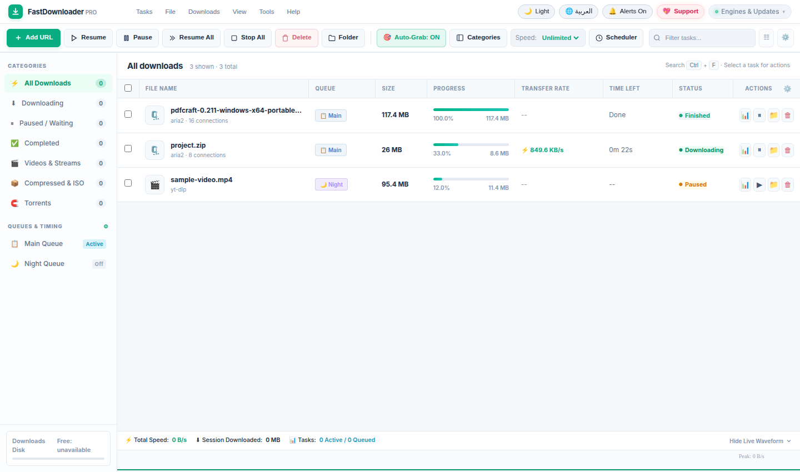

# Compact Desktop UI (design preview)

This branch integrates the approved compact Windows dashboard design without replacing the original download engine, APIs, task handlers, updater, or browser extension.

The screenshot uses simulated sample downloads for presentation. Real values continue to come from the existing task API.

## Source of truth

- `ui/compact-desktop.css` — maintainable compact visual tokens, layout, and responsive rules.
- `scripts/sync-compact-ui.py` — embeds the CSS in the existing self-contained `ui/index.html` dashboard. This script is idempotent.
- `tests/compact_ui.test.cjs` — verifies DOM hooks, existing actions, live filter counts, themes, JavaScript syntax, and CSS synchronization.

When adjusting compact styles, run `python3 scripts/sync-compact-ui.py` before committing. No external CSS HTTP route or runtime dependency is needed.

## Safety and QA

- The existing `ui/index.html` JavaScript download controls and backend endpoints remain intact.
- Existing saved theme preferences are respected. New installations default to the approved light design.
- The main table remains customizable, sortable, and horizontally scrollable on narrow desktop windows.
- Changes are confined to the dashboard, a small keyboard search shortcut, tests, and documentation.
- Before merging: verify the Windows CI executable and installer builds, then manually smoke-test an active and resumable download, browser capture, the native download dialog, and updater/restart on Windows.
